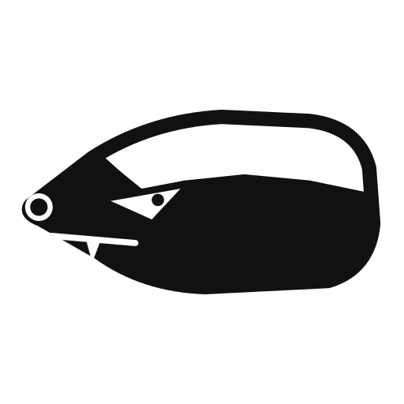

<p align="center">
  
</p>

# grounded-expert

[](https://github.com/pko89403/grounded-expert/releases)
[](LICENSE)

**English** | [한국어](README.ko.md) | [日本語](README.ja.md) | [简体中文](README.zh-CN.md)

A Claude Code plugin that spawns a subagent to answer domain questions by
actually retrieving primary sources (official specs, docs, papers, standards)
in real time and checking its own claims against them — instead of
role-playing an expert persona from memory.

## Example

```
/grounded-expert When a POST request gets an HTTP 301 redirect, may the client switch it to GET? Check against the RFCs.
```

Yes. RFC 9110 and RFC 7231 both say a client may change a POST to GET after a 301. The 301 text of both RFCs came through a summarizing fetch tool, so the quotes below are the tool's reproduction of each passage. I did not read the raw RFC text.

Level: standard  
Domain: http

| # | Claim | Tag | Quote | Source | URL |
|---|---|---|---|---|---|
| 1 | RFC 9110 lets a user agent change POST to GET after a 301. | EXTRACTED | "For historical reasons, a user agent MAY change the request method from POST to GET for the subsequent request." | RFC 9110, section 15.4.2 (301 Moved Permanently) | https://www.rfc-editor.org/rfc/rfc9110.html |
| 2 | The same permission was in RFC 7231 (since obsoleted by RFC 9110). | EXTRACTED | "For historical reasons, a user agent MAY change the request method from POST to GET for the subsequent request." | RFC 7231, section 6.4.2 (301 Moved Permanently) | https://www.rfc-editor.org/rfc/rfc7231.html |
| 3 | 308 is the permanent redirect that forbids the method change, for clients that need the method kept. | EXTRACTED | "except that it does not allow changing the request method from POST to GET." | RFC 7538, section 3 | https://www.rfc-editor.org/rfc/rfc7538.html |

Disconfirming search: ran — nothing opposing found

This is real output from grounded-expert v0.5.0 (one run on 2026-10-25). The excerpt keeps the conclusion, three claim rows and the disconfirming-search line; the full answer is below.

<details>
<summary>Full answer</summary>

Yes. RFC 9110 and RFC 7231 both say a client may change a POST to GET after a 301. The 301 text of both RFCs came through a summarizing fetch tool, so the quotes below are the tool's reproduction of each passage. I did not read the raw RFC text.

- **Current rule:** RFC 9110 section 15.4.2 says "For historical reasons, a user agent MAY change the request method from POST to GET for the subsequent request." It is a MAY, so the client is allowed to switch but not required to.
- **Predecessor:** RFC 7231 section 6.4.2 has the same permission.
- **Strict alternative:** RFC 7538 defines 308 (Permanent Redirect) for clients that must keep the method, because 308 does not allow the POST-to-GET change.

Level: standard
Domain: http
| # | Claim | Tag | Quote | Source | URL |
|---|---|---|---|---|---|
| 1 | RFC 9110 lets a user agent change POST to GET after a 301. | EXTRACTED | "For historical reasons, a user agent MAY change the request method from POST to GET for the subsequent request." | RFC 9110, section 15.4.2 (301 Moved Permanently) | https://www.rfc-editor.org/rfc/rfc9110.html |
| 2 | The same permission was in RFC 7231 (since obsoleted by RFC 9110). | EXTRACTED | "For historical reasons, a user agent MAY change the request method from POST to GET for the subsequent request." | RFC 7231, section 6.4.2 (301 Moved Permanently) | https://www.rfc-editor.org/rfc/rfc7231.html |
| 3 | 308 is the permanent redirect that forbids the method change, for clients that need the method kept. | EXTRACTED | "except that it does not allow changing the request method from POST to GET." | RFC 7538, section 3 | https://www.rfc-editor.org/rfc/rfc7538.html |
| 4 | RFC 7538 classes 301 as a permanent redirect that allows the POST-to-GET change. | EXTRACTED | "Allows changing the request method from POST to GET" | RFC 7538, Introduction (redirect classification table) | https://www.rfc-editor.org/rfc/rfc7538.html |
| 5 | RFC 2616 and RFC 1945 wording, which the task suggested for history, was not retrieved. | not confirmed | - | - |
| 6 | The WHATWG Fetch spec sets the method to GET for a POST after 301 or 302. I saw this only in search-result summaries of mailing-list threads, not on the spec page. | not confirmed | - | - |

Still uncertain:
- RFC 2616 and RFC 1945 were not retrieved, so the history of the rule is unverified.
- The WHATWG Fetch spec page was truncated before the HTTP-redirect fetch section, so browser behavior is not confirmed from a primary source.
- The RFC 9110 and RFC 7231 passages are the summarizing tool's rendering. An exact character match against the raw RFC text is not guaranteed.

Disconfirming search: ran — nothing opposing found

</details>

Claude Code plugin; Google Antigravity and ChatGPT/Codex support is experimental. Unverified claims are marked `not confirmed`.

## Why

Handing a subagent a persona ("you are an expert in X") makes it answer from
parametric memory while playing the role, so it states wrong facts as
confidently as right ones. This plugin enforces the procedure a real expert
follows instead: look things up, cite what you found, and correct yourself
when you're wrong.

## Install

```
/plugin install grounded-expert --marketplace pko89403/grounded-expert
```

(Claude Code 2.1.275 or later adds this repo as a marketplace source and
walks you through confirming it and picking an install scope — not a silent
one-step install. For the shell form instead of the slash command,
`claude plugin install grounded-expert --marketplace pko89403/grounded-expert`
needs Claude Code 2.1.292 or later.)

For local development: `claude plugin marketplace add <path-to-this-repo>`,
then `claude plugin install grounded-expert@grounded-expert`.

## Use with Google Antigravity (experimental)

Antigravity support is community-maintained and not covered by the Claude Code
eval suite. It is not yet verified that the `self` subagent it spawns gets web
search and URL-fetch tools. If it does not, the skill is instructed to tell you
the answer is not externally verified instead of answering from memory.

```
git clone https://github.com/pko89403/grounded-expert.git
cd grounded-expert
git checkout <release-tag>   # pin a release so the link does not follow a moving working tree
scripts/install-antigravity.sh --global          # Antigravity App/IDE: ~/.gemini/config/skills/
scripts/install-antigravity.sh --global --cli    # Antigravity CLI: ~/.gemini/antigravity-cli/skills/
cd <your-project> && <clone>/scripts/install-antigravity.sh --workspace   # <project>/.agents/skills/
```

Use `v0.1.1` or a later release tag: `v0.1.0` predates `hosts/antigravity/`.

The script symlinks `hosts/antigravity/` (not `plugin/`). Add `--uninstall` to
remove the link for the same mode. It never touches a real directory or a link
that points elsewhere. Skill locations follow
[Antigravity's skills docs](https://antigravity.google/docs/skills).

## Use with ChatGPT and Codex

The repository also ships an experimental portable Agent Plugins package for ChatGPT and
Codex. It stays outside `plugin/`, so the existing Claude Code package and eval
surface are unchanged.

```bash
codex plugin marketplace add /absolute/path/to/this-checkout
codex plugin add grounded-expert@grounded-expert
```

Use a checkout of `main` containing `hosts/openai/`; release tags through
`v0.3.0` do not contain it. This package has **not** been submitted to the
public Plugins Directory. ChatGPT local-source installation and execution have
not been verified end to end here. In Codex, explicitly request
`$grounded-expert:grounded-expert`; automatic trigger coverage is not certified.
The skill requests a fresh/no-history child only when the exposed tool supports
it, and discloses weaker isolation otherwise. Without delegation it must report
direct research; without source-retrieval tools it must report that external
verification was not possible. These are instructions, not enforced runtime
guarantees. See [OpenAI evaluation](docs/openai-evaluation.md) for observed failures,
reproduction steps, and the remaining release gate.

## Usage (Claude Code)

The skill fires automatically when a question needs domain-specific factual
accuracy, or when explicitly asked for an expert opinion/review. You can also
invoke it directly:

```
/grounded-expert <question>
```

**Cost note:** each invocation spawns a real subagent that does live
WebSearch/WebFetch calls and (on `standard`/`thorough`) a disconfirming-search
step — this is real API usage, not a cached/local lookup. `thorough` spawns
additional parallel subagents on top of that. Running the eval suite
(`claude plugin eval`) also costs real money per run (judge model + agent
model both bill).

### Levels

Pick (or let it infer) one level per question, not per session:

| Level | Behavior |
|---|---|
| **quick** | 1 source, no disconfirming-evidence search, 1 critique round. |
| **standard** (default) | 2+ independent sources, EXTRACTED/INFERRED tagging, up to 2 critique rounds incl. 1 disconfirming-evidence search. |
| **thorough** | standard, plus one additional subagent per candidate source type in parallel, cross-checked. For safety/legal/money stakes. |

Trigger words: "대충/빨리" → quick, "꼼꼼히/전부 확인해서" or legal/safety stakes →
thorough, nothing specified → standard.

## Plugin structure

```
.claude-plugin/marketplace.json  marketplace manifest; lists the plugin at ./plugin
.agents/plugins/marketplace.json ChatGPT/Codex marketplace manifest
plugin/                          the plugin itself (what users install)
  .claude-plugin/plugin.json     plugin manifest (name, version, description, author, homepage, repository)
  SKILL.md                       the grounded-expert skill definition (procedure, levels, gotchas)
  evals/                         eval cases (prompt.md + graders/*.md per case) for `claude plugin eval`
  README.md, LICENSE             short plugin-level README and license
hosts/openai/                    portable ChatGPT/Codex plugin and skill copy
README.md                        this file
CONTRIBUTING.md                  eval-gate process for PRs
CHANGELOG.md                     release history
assets/                          logo (SVG + PNG 512/128/32) and social preview
```

## Contributing

See [CONTRIBUTING.md](CONTRIBUTING.md) — a clean `claude plugin validate --strict`
run is not the same claim as a change being behaviorally safe; the
eval-gate process there explains why and what to run instead.

## Privacy

Claude Code: [plugin/PRIVACY.md](plugin/PRIVACY.md).
OpenAI host: [hosts/openai/PRIVACY.md](hosts/openai/PRIVACY.md).

## License

MIT — see [LICENSE](LICENSE).

## Versioning

SemVer, staying in the `0.x` range while the skill's procedure and eval
suite are still settling — a `0.x` version signals the API/behavior may
still change between minor bumps, without requiring a `1.0.0` promise of
stability we can't yet back up. Move to `1.0.0` once the eval suite is
stable and the plugin has run in production use for a while.
